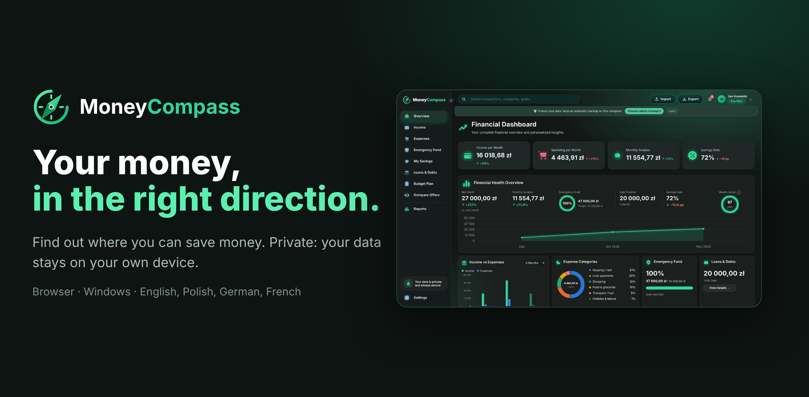

  

<h1 align="center">MoneyCompass</h1>

<b>Your money, in the right direction.</b> 
Personal finance for Poland – in your browser or on Windows. Private: your data stays on your own device.

  <a href="https://siewen.github.io/MoneyCompass/app/"><b>▶ Open MoneyCompass in your browser</b></a> ·
  <a href="https://siewen.github.io/MoneyCompass/">Website</a> ·
  <a href="https://github.com/siewen/MoneyCompass/releases/latest">Download for Windows</a>

## What it does

| | |
|---|---|
| 💸 **Inflows & outflows** | Salary, extra income and every expense in categories – averages over your real period, filters, search, repeats |
| 🛟 **Emergency fund** | How much you need for 3–6 months and how far you are |
| ⚡ **Optimize my finances** (Pro) | A personal plan: best savings accounts and deposits today, which loan to pay off first, overpaying vs. saving |
| 🏦 **Bank import (CSV)** (Pro) | PKO BP, mBank, ING, Millennium, Pekao, Santander and others – with smart categories that learn from your changes |
| 〰️ **Trends** | Smooth lines for inflows, outflows, what you saved and loan payments, month by month |
| 📅 **Calendar** (Pro) | Everything that comes back, with a forecast for the coming months |
| 💳 **Loans vs. the market** (Pro) | Your rate compared with today's best offers, with the new payment and the real saving |
| 🎯 **Savings & goals** | All your money in one place, promotion reminders, savings goals (Pro) |
| 🔒 **PIN & lock** | A PIN per profile, automatic lock, backups encrypted with a password (AES-256) |
| 🎨 **Design** | Emerald – side menu on computers, app-like bottom bar on phones |

Made for Poland: NBP rates, treasury bonds, IKE/IKZE and bank offers, checked every day. Available in Polish, English, German and French.

## Privacy

No account, no sign-in, no cloud. Everything is saved on your own device. MoneyCompass only downloads public numbers (NBP rates, bond rates, bank offers).

MoneyCompass is not financial advice – see the [Terms of use](https://siewen.github.io/MoneyCompass/terms.html) and [Privacy policy](https://siewen.github.io/MoneyCompass/privacy.html).
